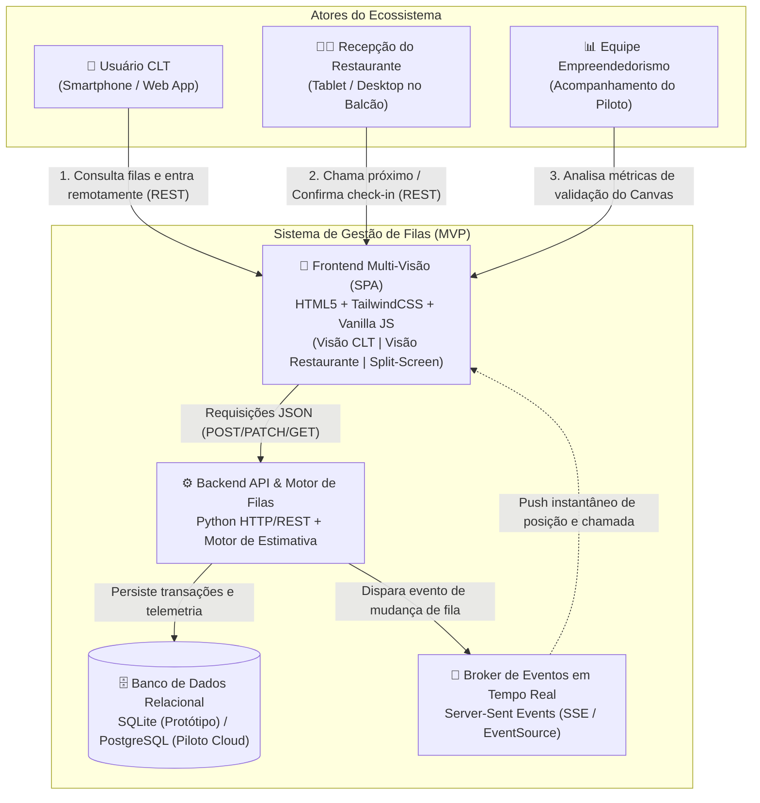
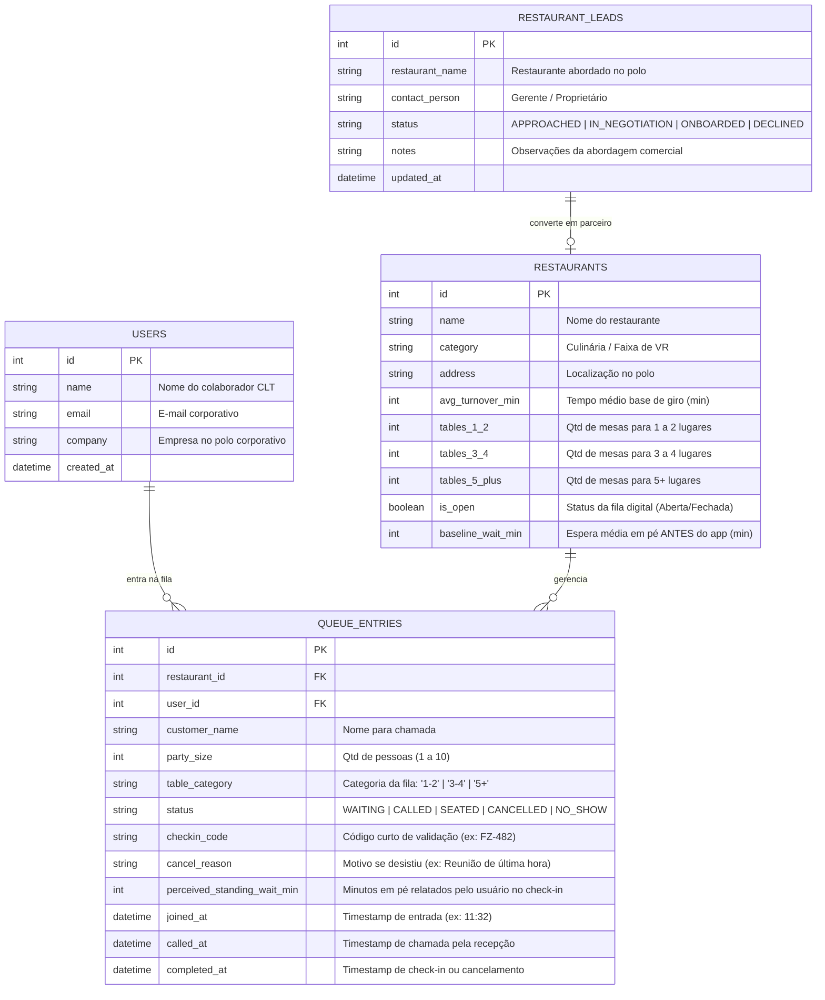
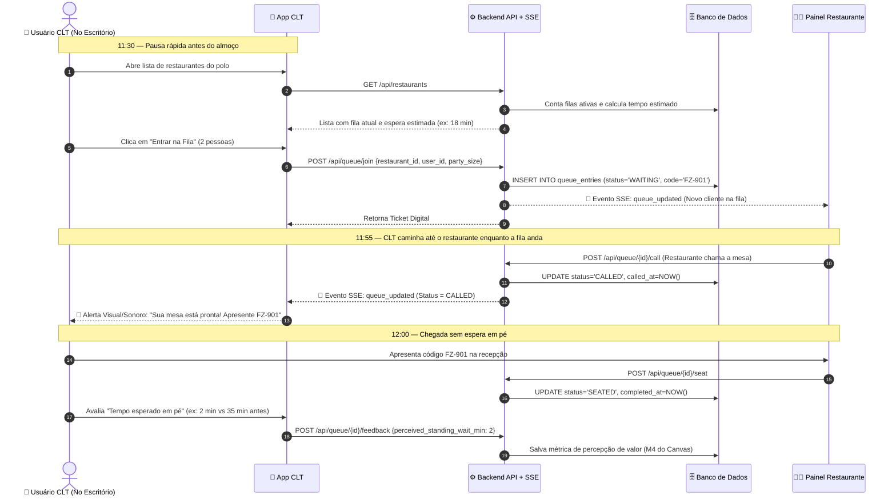
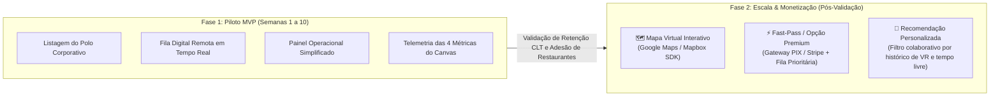

# Arquitetura do Sistema — MVP Gestão de Filas para Restaurantes (FilaZero CLT)

**Disciplina:** Empreendedorismo (UFRJ — 2026.2)  
**Grupo:** Arthur Monteiro, Carolina Falcão, Fernando Bruzzi e Vivian Souza  

---

## 1. Alinhamento Estratégico com o MVP Canvas

A arquitetura foi desenhada seguindo estritamente o recorte de validação de hipóteses definido no [Canva.txt](file:///home/vivian/UFRJ/2026-2/MVP_Empreendedorismo/Canva.txt) e no [canvas_mvp.jpeg](file:///home/vivian/UFRJ/2026-2/MVP_Empreendedorismo/canvas_mvp.jpeg):

| Bloco do Canvas | Decisão Arquitetural no MVP |
| :--- | :--- |
| **Personas Segmentadas** | **1. CLTs sem tempo:** Interface mobile-first focada em entrada na fila em menos de 15 segundos (às ~11h30, ainda no escritório).<br>**2. Restaurantes parceiros:** Painel web simplificado (tablet/balcão) de 1 toque para chamar mesas sem fricção operacional. |
| **Jornada Melhorada** | Notificações em tempo real (Server-Sent Events / Push) permitem que o usuário saia do escritório apenas quando sua posição estiver próxima, convertendo 30–40 min de fila em pé em tempo livre de descanso pós-almoço (12h40–13h30). |
| **Escopo Enxuto (Core MVP)** | Foco exclusivo em **Descoberta de Restaurantes do Polo**, **Entrada/Acompanhamento de Fila Digital** e **Painel do Restaurante**. Funcionalidades de *Mapa Virtual*, *Recomendação via IA* e *Fast-Pass Premium* foram isoladas para a Fase 2 (Pós-Validação). |
| **Validação de Hipóteses** | Coleta nativa de telemetria no banco de dados para medir as **4 métricas do Canvas**: conversão de restaurantes, entradas/usuário/semana, taxa de desistência e redução do tempo percebido de espera em pé. |
| **Custo & Cronograma** | Arquitetura monolítica modular com banco relacional leve e comunicação reativa via HTTP/SSE, permitindo entrega em **4 a 6 semanas** com custo de infraestrutura próximo de zero durante o piloto de **3 a 4 semanas**. |

---

## 2. Visão de Arquitetura (Modelo C4 — Contexto e Containers)

O diagrama abaixo representa os componentes do MVP, separando as três interfaces (App CLT, Painel do Restaurante e Dashboard de Métricas do Piloto) conectadas ao backend reativo.



---

## 3. Modelo Conceitual e Lógico de Dados (MER / DER)

O modelo de dados foi projetado para suportar tanto a operação de fila em tempo real quanto a extração direta das **4 métricas de validação do MVP Canvas**.



### Segmentação de Filas por Tamanho de Mesa e Cálculo de Espera ($T_{\text{espera}}$)

Em um restaurante real, uma dupla (**1–2 lugares**) não compete na mesma fila de uma equipe grande (**5+ lugares**). Por isso, o motor de filas particiona a fila de cada restaurante em **3 categorias independentes** ($c \in \{\text{'1-2'}, \text{'3-4'}, \text{'5+'}\}$):

$$T_{\text{espera}}(p_c, c) = \left\lceil \frac{p_c \times T_{\text{giro}}(c)}{\text{FatorMesas}(c)} \right\rceil$$

Onde:
- $p_c$: posição do grupo **apenas dentro da fila da sua categoria de mesa $c$** (ex: 1º da fila de mesas para 2 pessoas, mesmo que haja 4 grupos esperando mesa de 4 lugares).
- $T_{\text{giro}}(c)$: tempo médio de giro ajustado pelo porte da mesa (mesas de 1–2 lugares giram mais rápido; mesas de 5+ lugares exigem junção de mesas e têm giro ~1.4x maior).
- $\text{FatorMesas}(c)$: vazão paralela proporcional à quantidade de mesas daquela categoria no salão (`tables_1_2`, `tables_3_4`, `tables_5_plus`).

---

## 4. Fluxos em Tempo Real (Diagramas de Sequência)

### 4.1. Jornada Principal: Entrada Remota às 11h30 e Chamada de Mesa



---

## 5. Rastreabilidade das Métricas do MVP Canvas

Cada métrica listada no bloco **"Métricas para validar as hipóteses do negócio"** do Canvas possui uma consulta dedicada na camada de dados (`/api/metrics`):

1. **Taxa de conversão de restaurantes abordados (`M1`):**
   $$\text{Conversão} = \frac{\text{COUNT}(\text{RESTAURANT\_LEADS onde status = 'ONBOARDED'})}{\text{COUNT}(\text{RESTAURANT\_LEADS totais})} \times 100$$
2. **Número de entradas registradas na fila digital por usuário/semana (`M2`):**
   $$\text{Recorrência Semanal} = \frac{\text{Total de entradas na semana}}{\text{Usuários CLT ativos na semana}}$$
3. **Taxa de desistência ou cancelamento da fila antes de ser chamado (`M3`):**
   $$\text{Taxa de Abandono} = \frac{\text{COUNT}(\text{status} \in \{\text{'CANCELLED'}, \text{'NO\_SHOW'}\})}{\text{COUNT}(\text{entradas finalizadas ou canceladas})} \times 100$$
4. **Redução no tempo percebido de espera em pé (`M4`):**
   $$\text{Redução (\%)} = \left(1 - \frac{\text{AVG}(\text{perceived\_standing\_wait\_min})}{\text{AVG}(\text{baseline\_wait\_min})}\right) \times 100$$

---

## 6. Especificação dos Endpoints da API (MVP)

| Método | Rota | Descrição |
| :--- | :--- | :--- |
| `GET` | `/api/state` | Retorna estado consolidado (restaurantes, filas ativas, usuários CLT e métricas do Canvas). |
| `GET` | `/api/events` | Stream **Server-Sent Events (SSE)** para atualização instantânea de todas as telas abertas. |
| `POST` | `/api/queue/join` | Registra entrada de um usuário CLT na fila de um restaurante e gera código de check-in. |
| `POST` | `/api/queue/action` | Executa transições de estado (`call`, `seat`, `cancel`, `noshow`) e dispara broadcast SSE. |
| `POST` | `/api/queue/feedback` | Registra o tempo percebido de espera em pé informado pelo usuário após sentar. |
| `POST` | `/api/restaurants/toggle` | Abre/pausa a fila digital ou ajusta o tempo médio de giro do restaurante. |
| `POST` | `/api/leads/add` | Registra ou atualiza restaurante abordado no funil comercial do piloto (Métrica M1). |
| `POST` | `/api/demo/reset` | Restaura os dados iniciais de demonstração para apresentações da disciplina. |

---

## 7. Roadmap de Evolução Arquitetural (Pós-MVP)

Conforme recomendado em [Canva.txt](file:///home/vivian/UFRJ/2026-2/MVP_Empreendedorismo/Canva.txt), os blocos mais complexos do BMC foram isolados para a Fase 2 após validação das 4 semanas de piloto:



---

## 8. Como Executar o Protótipo Funcional

O protótipo foi construído em **Python 3 puro (zero dependências externas)** com **SQLite** e **Server-Sent Events (SSE)**:

```bash
python3 app.py
```

Acesse no navegador: **`http://localhost:8765`**

- Use o modo **"Apresentação Split-Screen (CLT + Restaurante)"** no topo da página para demonstrar ao vivo a entrada na fila pelo celular do CLT à esquerda e o acionamento da mesa pelo restaurante à direita.
- Acesse a aba **"Métricas do Canvas (Validação)"** para visualizar os 4 indicadores sendo recalculados em tempo real conforme você interage com o protótipo.
